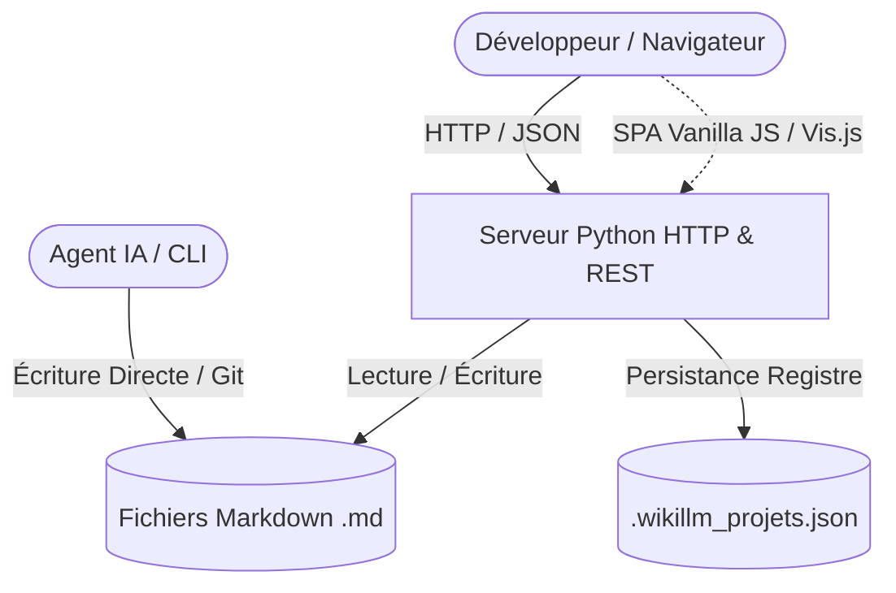

# 🏛️ Architecture et Principes de Conception

**Dernière mise à jour** : 2026-09-25  
**Auteur** : Équipe de développement WikiLLM  
**Public cible** : Architectes, Développeurs, Agents IA

---

## 🧭 Vue d'ensemble du Système

WikiLLM est conçu comme un pont léger et temps réel entre l'agent d'ingénierie logicielle (LLM), le développeur et la base de connaissances du projet.

---

## 🧩 Composants Principaux

### 1. Serveur HTTP & API REST (`serveur.py`)
- **Responsabilité** : Écouter sur les interfaces réseau, servir les ressources statiques (SPA `index.html`), exposer les routes API pour la lecture/écriture des fichiers Markdown et calculer le graphe relationnel.
- **Interfaces** : REST HTTP JSON (`/api/*`), Web Server statique.

> ### 🏛️ Architecture Decision (ADR)
> **Statut** : Accepté  
> **Contexte** : Garantir une portabilité universelle sans risque de conflit d'environnement virtuel ou d'installation de paquets manquants.  
> **Décision** : Utiliser exclusivement la bibliothèque standard Python 3 (`http.server`, `urllib`, `socket`, `json`, `pathlib`).  
> **Conséquences & Trade-offs** :
> - 🟢 **Avantages** : Démarrage immédiat sur n'importe quel OS (Linux, macOS, Windows) sans `pip install`.
> - 🔴 **Limites** : Serveur mono-thread de base (largement suffisant pour un usage local ou équipe restreinte).

---

### 2. Interface Utilisateur Monopage (`index.html`)
- **Responsabilité** : Fournir une interface soignée intégrant un visualiseur Markdown enrichi, un éditeur avec raccourcis clavier, un explorateur multi-projets et un moteur de graphe dynamique.
- **Interfaces** : Intégration CDN pour les librairies de rendu (Marked.js, Highlight.js, Vis-Network).

> ### 🏛️ Architecture Decision (ADR)
> **Statut** : Accepté  
> **Contexte** : Offrir une navigation fluide d'une note à l'autre sans rechargement de page complet.  
> **Décision** : Routage côté client (SPA) intercepté par `serveur.py` qui renvoie `index.html` pour toute URI ne comportant pas d'extension de fichier statique.  
> **Conséquences & Trade-offs** :
> - 🟢 **Avantages** : URL propres (ex: `http://localhost:8000/wikiK/architecture/vue-ensemble`), expérience utilisateur fluide.
> - 🔴 **Limites** : Les assets statiques doivent posséder une extension explicite (`.css`, `.js`, `.png`).

---

### 3. Moteur de Graphe de Connaissances
- **Responsabilité** : Analyser les liens internes Markdown et les wikilinks pour construire un réseau de dépendances et de relations.
- **Syntaxe supportée** : `[[nom_note]]`, `[[dossier/nom_note]]`, `[[cible|libellé]]`, syntaxe standard Markdown `[libellé]\(chemin\)`.

> ### 🏛️ Architecture Decision (ADR)
> **Statut** : Accepté  
> **Contexte** : Construire instantanément le graphe lors des requêtes sans pénalité de temps de réponse.  
> **Décision** : Analyse regex optimisée multi-motifs compilée à la volée sur les fichiers `.md`.  
> **Conséquences & Trade-offs** :
> - 🟢 **Avantages** : Temps d'exécution < 10ms pour plusieurs centaines de notes.
> - 🔴 **Limites** : Tolérance syntaxique standard sans analyse fine de l'AST Markdown complet.

---

## 🔐 Sécurité & Intégrité du Système de Fichiers

- **Prévention du Path Traversal** : Toutes les routes manipulant des fichiers (`/api/fichier`, `/api/sauvegarder`, `/api/supprimer`) vérifient rigoureusement que le chemin absolu calculé se trouve strictement confiné dans le sous-dossier `wiki/` du projet actif (`full_path.startswith(os.path.abspath(dossier_wiki))`).
- **Encodage** : Tout le transport et le stockage sont strictement forcés en UTF-8.
