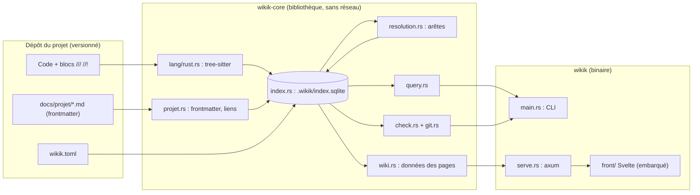

# Architecture de wikik v1

> Le détail de chaque module est dans son en-tête `//!` : `wikik query carte` ou la zone Produit du wiki. Cette page donne la vue d'ensemble et les flux.

## Composants

## Flux d'une requête

1. `Index::ouvrir` : ouvre ou recrée l'index si le schéma ou les règles d'extraction ont changé ([[adr/0003-index-sqlite-non-versionne]]).
2. `Index::mettre_a_jour` : liste les fichiers (`.gitignore` et `wikik.toml` respectés), ne relit que ceux dont la taille, la date puis le hash ont changé, recalcule toutes les arêtes si quelque chose a changé ([[SPEC-03]]).
3. La requête lit SQLite ; `check` et le statut de doc interrogent git pour la référence de chaque bloc ([[adr/0006-perime-reference-git]]).

## Règles transverses

- **Déterminisme** : dump JSON trié, sans horodatage ; testé par instantané ([[ENF-002]]).
- **Une seule écriture dans le code** : `wikik relu`, qui ne touche qu'une ligne `@relu`.
- **Aucune écriture par le réseau** : le serveur n'a que des routes `GET` ([[SPEC-09]]).
- **Le front n'a pas de logique métier** : il affiche les structures de `wiki.rs`, dont les types TypeScript sont générés ([[adr/0004-front-typescript-wasm-reserve]]).
