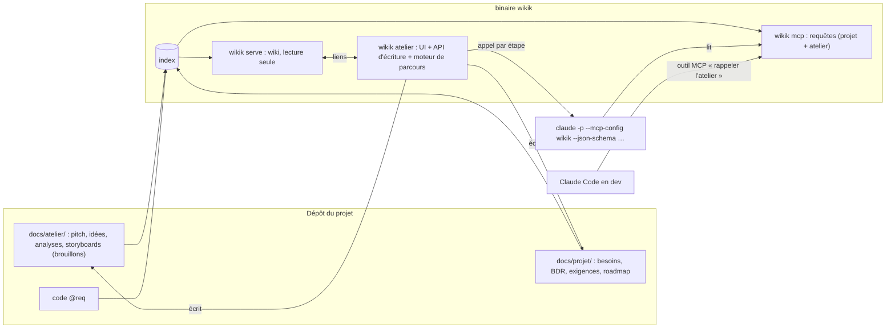

# Plan v4 : l'atelier de définition du besoin

> Rédigé à partir des décisions B1 à B7 de [[majeures/v4/cadrage]]. Rien n'est développé avant que Tibo valide ce plan, puis la BDR et le cahier des charges de la v4 (règle D13).

---

## 1. Ce que la v4 doit livrer

**En une phrase** : `wikik atelier`, une application qui conduit un projet du pitch jusqu'au cahier des charges et à la roadmap, avec un LLM qui propose et Tibo qui choisit ; ses résultats sont des fichiers du dépôt, lus par le wiki et par l'agent de code, qui peut rouvrir l'atelier sur un besoin en plein développement.

**Décisions de cadrage**

| # | Décision |
|---|---|
| B1 | Le framework Fast Design Thinking est versionné et publié dans le dépôt. |
| B2 | L'atelier est une application vivante, pierre angulaire du projet ; serveur séparé, relié au wiki (qui reste en lecture seule). |
| B3 | Données = fichiers Markdown du dépôt (`docs/atelier/`), même structure que la zone Projet. |
| B4 | LLM via le CLI local (`claude -p`, abonnement) derrière une couche fournisseur générique ; le LLM lit l'atelier et le projet par le serveur MCP de wikik. |
| B5 | Terrains : un projet neuf (app « météo » crypto / investissement) pour le lancement ; ATS pour le rappel en cours de développement. |
| B6 | Modes Express et Complet ; le LLM propose en lot, Tibo garde, corrige ou rejette ; étape 0 « Pitch ». |
| B7 | L'atelier va jusqu'au cahier des charges et à la roadmap ; specs, ADR et code restent à Claude Code. |

**La v4 est terminée quand** (définition de fini) :
1. Le projet « météo » est lancé de bout en bout dans l'atelier, en mode Express : pitch, idéation, raffinage, SCAMPER, storyboards, besoins, BDR 1 et 2, exigences avec critères d'acceptation, roadmap. Tout est dans son dépôt, `wikik check` passe sans erreur, et chaque exigence remonte à un besoin, chaque besoin à sa source dans l'atelier.
2. Sur ATS, Claude Code rouvre l'atelier sur une exigence existante (`AC-019`), la discussion précise le besoin, et la page de l'exigence en garde la trace.
3. Le wiki affiche l'atelier et navigue dans les deux sens : exigence → besoin → storyboard → idée, et inversement.
4. Le framework réécrit (une fiche par technique) remplace le méga-prompt ; chaque technique utilisée en Express a son écran.
5. Aucune écriture hors de `docs/atelier/` et `docs/projet/` ; le wiki reste en lecture seule ; aucune clé d'API stockée.

---

## 2. Architecture cible

- **Un binaire, trois façades** : `serve` (lecture), `atelier` (écriture et LLM), `mcp` (agents). Même index, mêmes fichiers.
- **Le moteur de parcours** décrit chaque technique par une **fiche déclarative** (entrées, sorties, schéma JSON des artefacts, consignes, réglages Express et Complet), au lieu du méga-prompt de 216 Ko.
- **Chaque appel au LLM** : `claude -p` avec le serveur MCP de wikik (outils en lecture seule), la fiche de la technique en consigne, un schéma JSON pour la réponse ; l'atelier valide la réponse puis l'affiche en propositions.

---

## 3. Les phases

| Phase | Contenu | Taille (jours effectifs) | Jalon |
|---|---|---|---|
| 0 | Mise en place : framework dans le dépôt, ADR de cadrage | ½ | |
| 1 | Spike : `claude -p` + MCP wikik + `--json-schema` | ½ à 1 | |
| 2 | BDR v4 + cahier des charges v4 | 1 | |
| 3 | Réécriture du framework en fiches + specs socle | 3 à 4 | **Porte : feu vert pour coder** |
| 4 | Modèle de données de l'atelier et lecture par l'index | 2 | |
| 5 | Serveur atelier, fournisseur LLM, moteur de parcours | 4 à 6 | |
| 6 | UI : stepper, écran générique, écrans du mode Express | 6 à 9 | **Atelier utilisable** |
| 7 | Production vers `docs/projet/` : besoins, BDR, exigences, roadmap | 2 à 3 | |
| 8 | Liens wiki ↔ atelier et rappel par MCP | 2 | |
| 9 | Lancement réel du projet « météo » + rappel sur ATS | 2 à 3 | |
| 10 | Clôture v4 | 1 | **v4.0** |

Les phases 7 et 8 peuvent se chevaucher avec la fin de la phase 6.

### Phase 0 : mise en place (½ jour)
- Copier le framework d'origine tel quel dans `atelier/framework/source/` (B1) ; il sert de référence à la réécriture.
- ADR : serveur atelier séparé du wiki (B2), données en fichiers (B3), LLM par CLI + MCP (B4).
- **Sortie** : ADR écrits, framework versionné.

### Phase 1 : spike (½ à 1 jour, jetable)
Questions à trancher sur du concret avant d'écrire les specs :

| # | Question |
|---|---|
| S1 | `claude -p --mcp-config` appelle-t-il bien les outils de wikik sans interaction (`--allowedTools mcp__wikik__*`) ? |
| S2 | `--json-schema` rend-il un JSON conforme à chaque fois ? Que faire quand il échoue ? |
| S3 | Durée d'un appel (idéation : 5 variantes) : quelques secondes ou une minute ? Le flux `stream-json` permet-il d'afficher la progression ? |
| S4 | Limites d'usage de l'abonnement sur une séance Express complète (nombre d'appels) ? |
| S5 | Appels concurrents possibles (deux étapes en parallèle) ? |

**Sortie** : note `docs/projet/spikes/spike-02-claude-cli-mcp.md`.

### Phase 2 : BDR + cahier des charges v4 (1 jour)
BDR 1 (irritants du framework en chat : ~45 sous-analyses, validation à la chaîne, relais par copier-coller, formats visuels joués en texte), BDR 2 (objectifs de la section 1, besoins), exigences `EF-1xx` avec critères. **Sortie** : validés par Tibo.

### Phase 3 : framework réécrit + specs socle (3 à 4 jours) : porte
- **Une fiche par technique** dans `atelier/techniques/` : Pitch, Free writing (C.I.S. / P.A.R.S.), Carte mentale (C.A.R.T.E. / V.E.C.T.), Pensée analogique (C.I.L. / P.O.N.T.), 5W1H (C.E.S.), Cubing (C.A.R.), SCAMPER, Storyboard (R.E.C.I.T.), Bilan des besoins (B.I.L.A.N.), Exigences (nouvelle), Roadmap (R.O.A.D.). Chaque fiche : rôle, entrées (types d'artefacts lus), sorties (schéma JSON), consignes au LLM, règles de validation, réglages Express et Complet, exemple « MyRandonnée » repris du framework comme jeu de test.
- **Specs** : SPEC-17 modèle de données de l'atelier (types d'artefacts, identifiants `PITCH`, `IDEE-xxx`, `ANA-xxx`, `SCA-xxx`, `SB-xxx`, liens `sources` pour la traçabilité) ; SPEC-18 moteur de parcours (étapes, états, Express / Complet, reprise) ; SPEC-19 fournisseur LLM (CLI, MCP, schéma, erreurs, journal des appels) ; SPEC-20 écrans de l'atelier (maquettes) ; SPEC-21 liens wiki ↔ atelier et rappel.
- **Porte** : fiches et specs validées par Tibo.

### Phase 4 : modèle de données (2 jours)
L'index lit `docs/atelier/` (nouveaux types de documents, liens `sources`) ; `check` vérifie la traçabilité (exigence sans besoin, besoin sans source) ; le serveur MCP expose l'atelier.

### Phase 5 : serveur atelier (4 à 6 jours)
`wikik atelier` : API d'écriture limitée à `docs/atelier/` et `docs/projet/`, sur la boucle locale par défaut ; fournisseur LLM générique (CLI configurable dans `wikik.toml`, fournisseur factice pour les tests) ; moteur de parcours qui charge les fiches, prépare l'appel, valide la réponse, enregistre les propositions ; journal des appels (durée, technique, résultat).

### Phase 6 : interface (6 à 9 jours) : atelier utilisable
Svelte, même socle que le wiki. Stepper des étapes avec avancement (remplace E.T.A.T.) ; **écran générique « propositions → sélection »** (garder, corriger, rejeter, redemander) utilisé par toutes les techniques ; écrans dédiés au mode Express : pitch (formulaire), free writing (éditeur), carte mentale (canevas), grille SCAMPER, planche de storyboards, tri des besoins (glisser-déposer), tableau des exigences, roadmap en trois colonnes.

### Phase 7 : production de la doc (2 à 3 jours)
Besoins `B-xxx`, BDR 1 et 2, exigences `EF-xxx` et roadmap écrits dans `docs/projet/` avec les gabarits existants, en statut `proposé` ; chaque fichier cite ses sources dans l'atelier.

### Phase 8 : liens et rappel (2 jours)
Wiki : bouton « ouvrir dans l'atelier » sur un besoin ou une exigence ; atelier : lien « voir dans le wiki ». Outil MCP `atelier_rappel <id>` : Claude Code ouvre une séance de clarification sur un besoin, une exigence ou un storyboard ; la séance est enregistrée et liée.

### Phase 9 : lancement réel (2 à 3 jours)
Projet « météo » lancé de bout en bout en Express ; rappel sur `AC-019` d'ATS. Mesures : durée de la séance, nombre d'appels, propositions gardées ou rejetées, ressenti de Tibo. **Sortie** : `MESURE-03`.

### Phase 10 : clôture (1 jour)
Définition de fini cochée, backlog mis à jour, tag `v4.0`.

---

## 4. Risques

| Risque | Effet | Parade |
|---|---|---|
| Appels `claude -p` lents (dizaines de secondes) | Atelier pénible à l'usage | Spike S3 ; propositions générées en tâche de fond avec progression ; plusieurs variantes par appel |
| Limites d'usage de l'abonnement | Séance interrompue | Spike S4 ; mode Express sobre ; fournisseur API possible plus tard (B4) |
| Réponses mal formées | Écran vide ou faux | `--json-schema` + validation + une relance automatique, puis message clair |
| Réécriture infidèle au framework | Perte de ce qui fait sa valeur | Exemple MyRandonnée de chaque fiche rejoué comme test ; relecture des fiches par Tibo en phase 3 |
| Trop d'écrans dédiés | La v4 ne sort pas | Écran générique d'abord ; écrans dédiés seulement pour le mode Express |
| Atelier exposé sur le réseau | Écriture par n'importe qui | Boucle locale par défaut ; `--autoriser-reseau` explicite, comme `serve` |

## 5. Questions encore ouvertes (défaut proposé)

| Question | Défaut | Tranchée en |
|---|---|---|
| Framework de l'interface | Svelte, comme le wiki | Phase 3 (SPEC-20) |
| Atelier dans un navigateur ou en application de bureau (Tauri) | Navigateur | Phase 3 |
| Plusieurs personnes dans la même séance | Non (A1, solo) | Plus tard |
| Langue de l'atelier | Français | Phase 3 |

## 6. Suivi

| Phase | Statut | Date |
|---|---|---|
| Cadrage B1-B7 | ✅ | 2026-10-18 |
| 0 Mise en place | ✅ framework versionné, ADR-0009 à 0011 | 2026-10-18 |
| 1 Spike | ✅ SPIKE-02 : 6 à 10 s par appel, MCP et JSON structuré fiables | 2026-10-18 |
| 2 BDR + CdC | ✅ proposé (validation déléguée) : 3 besoins, EF-100 à 112, ENF-007 et 008 | 2026-10-18 |
| 3 Fiches + specs (porte) | ✅ 12 fiches (atelier/techniques/), SPEC-17 à 21 ; porte franchie par délégation | 2026-10-18 |
| 4 à 10 | ⏳ | |
