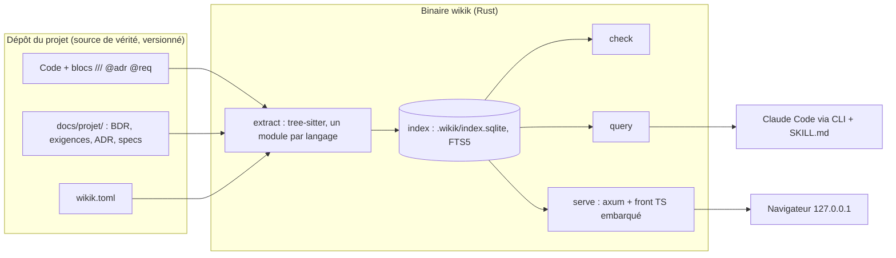
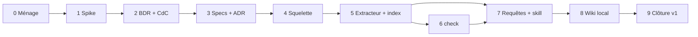

# Plan de développement : wikiK v1 (refonte Rust)

> Document de travail pour Tibo et Claude Code. Il remplace la section 8 (« Roadmap par phases ») de `roadmap-fusion-wikillm-docascode.md`, en appliquant les décisions A1 à A6 de l'analyse du 17/10/2026.
> Règle : on ne code pas la cible avant la fin de la Phase 3 (BDR, cahier des charges, specs socle et ADR validés). Les phases 0 et 1 (ménage, spike jetable) font exception.

---

## 1. Ce que la v1 doit livrer

**En une phrase** : un binaire Rust `wikik` qui indexe la doc écrite dans le code d'un projet, détecte la doc périmée et répond aux questions de l'agent de code à faible coût en tokens, puis affiche le tout dans un wiki local.

**Décisions de cadrage**

| # | Décision |
|---|---|
| A1 | Solo et local en v1 ; architecture prête pour l'équipe (écriture uniquement via les fichiers du dépôt, index déterministe non versionné, un fichier par identifiant, cœur = bibliothèque + CLI). |
| A2 | Cœur en Rust, un seul binaire : extracteur tree-sitter, index SQLite, `check`, CLI, serveur de prévisualisation. `serveur.py` n'est pas porté. |
| A3 | Front en TypeScript, assets embarqués dans le binaire, types générés depuis Rust. WebAssembly réservé au moteur de requêtes du futur site statique. |
| A4 | Terrains d'essai dans l'ordre : l'outil lui-même, ATS, puis un projet shelley (après la v1). |
| A5 | Index et requêtes agent d'abord, wiki ensuite. Atelier Fast Design Thinking hors v1. |
| A6 | Processus allégé : spike, BDR + cahier des charges courts, 4 specs socle, ADR 002 à 005 ; les autres specs juste avant leur phase. |

**La v1 est terminée quand** (définition de fini) :
1. Sur ATS, une session Claude Code répond à « que dois-je relire avant de modifier X ? » via `wikik impact` sans ouvrir de fichier source, et le coût en tokens est mesuré contre une session sans l'outil.
2. `wikik check` signale toute fonction dont le code a changé sans que son bloc de doc suive.
3. `wikik serve` affiche le wiki de wikiK et d'ATS : zone Produit (générée depuis le code) et zone Projet (`docs/projet/`).
4. Chaque exigence `must` du cahier des charges v1 est implémentée et citée par du code ou un test (`@req`).
5. wikiK se documente avec lui-même : son propre wiki v0 est migré, `serveur.py` et `index.html` sont retirés.

---

## 2. Architecture cible de la v1

### 2.1 Vue d'ensemble



Le futur MCP, la CI et le site statique WASM se brancheront sur `query` et `check` sans toucher au cœur (backlog).

### 2.2 Organisation du dépôt (proposition, à figer dans l'ADR 005)

La refonte se fait **dans ce dépôt** (`wikiK`), pour garder l'historique et le wiki existant comme matière de migration.

```text
wikiK/
├── Cargo.toml                 # workspace
├── crates/
│   ├── wikik-core/            # bibliothèque : modèle, extract, index, check, query
│   │   ├── src/lang/rust.rs   # un module par langage (trait Language)
│   │   └── queries/rust.scm   # requêtes tree-sitter
│   └── wikik/                 # binaire : CLI (clap) + serve (axum)
├── front/                     # TypeScript (Vite), compilé puis embarqué dans le binaire
├── skill/                     # SKILL.md + procédures pour l'agent
├── templates/                 # gabarits docs/projet/ pour un projet neuf
├── tests/fixtures/            # mini-projets de test
├── docs/projet/               # zone Projet de wikiK lui-même
└── legacy/                    # v0 Python, supprimé en Phase 9
```

Dans un projet qui utilise l'outil :

```text
mon-projet/
├── wikik.toml                 # langages, chemins exclus, règles de check
├── docs/projet/
│   ├── majeures/v1/{bdr-1-analyse,bdr-2-definition,cahier-des-charges}.md
│   ├── besoins/B-001.md       # un fichier par identifiant (A1)
│   ├── exigences/EF-001.md
│   ├── adr/0002-....md
│   └── specs/SPEC-01-....md
├── src/...                    # code + blocs (zone Produit)
└── .wikik/                    # index, ignoré par git
```

Nom de l'outil, du binaire et du dossier d'index : `wikik` est un **nom de travail** (Q6), à confirmer dans l'ADR 005.

---

## 3. Les phases

Vue d'ensemble. Les tailles sont en **jours de travail effectif** (une journée de travail concentré, environ 6 h, en binôme avec Claude Code) ; ce sont des ordres de grandeur, pas des engagements :

| Phase | Contenu | Taille | Jalon |
|---|---|---|---|
| 0 | Ménage et socle de travail | ½ jour | |
| 1 | Spike tree-sitter sur ATS (jetable) | ½ à 1 jour | |
| 2 | BDR + cahier des charges v1 | 1 jour | |
| 3 | 4 specs socle + ADR 002 à 005 | 2 à 3 jours | **Porte : feu vert pour coder** |
| 4 | Squelette Rust | 1 jour | |
| 5 | Extracteur + index | 4 à 6 jours | |
| 6 | `check` | 2 à 3 jours | |
| 7 | CLI de requêtes + SKILL.md + amorçage ATS | 4 à 6 jours | **v1-agent : utilisable au quotidien** |
| 8 | Wiki local (serve + front TS) | 6 à 10 jours | |
| 9 | Clôture v1 et migration de wikiK | 1 à 2 jours | **v1.0** |



Les phases 6 et 7 peuvent se chevaucher une fois le schéma d'index figé (fin de la Phase 5).

---

### Phase 0 : Ménage et socle de travail (½ jour)

**But** : repartir d'un dépôt propre, sans perdre la v0.

1. Commiter le travail non commité du 28/09 tel quel, en un commit « snapshot v0 », et poser un tag `v0-python`.
2. Déplacer `serveur.py`, `index.html` et le dossier `docs/` Diátaxis (doublon de `wiki/documentation/`) dans `legacy/`. La v0 reste lançable depuis `legacy/` jusqu'à la Phase 9.
3. Créer `CLAUDE.md` à la racine : pointeur vers ce plan, règle « pas de code cible avant la porte de la Phase 3 », conventions de commit, règle « doc dans le même commit que le code ».
4. Mettre `.wikik/` et `spikes/` dans `.gitignore`.

**Critère de sortie** : `git status` propre, tag `v0-python` posé, `CLAUDE.md` relu par Tibo.

---

### Phase 1 : Spike tree-sitter sur ATS (½ à 1 jour, jetable)

**But** : vérifier sur du vrai code Rust les hypothèses dont dépend le modèle d'index, avant d'écrire SPEC-02 et SPEC-03.

Code dans `spikes/tree-sitter-rust/` (ignoré par git), lancé sur ATS (11 000 lignes, workspace de 3 crates, Leptos + Tauri : bon cas difficile).

| # | Question | Ce qu'on mesure |
|---|---|---|
| S1 | **Identifiant stable de symbole** | Forme `chemin::Type::methode` : tient-elle pour `impl Type`, `impl Trait for Type`, génériques, `mod` imbriqués, `#[cfg(test)] mod tests`, fonctions `#[component]` de Leptos ? Quels cas collisionnent ? |
| S2 | **Hash du corps** | Hash des tokens du corps sans commentaires ni blancs : stable après `cargo fmt` ? Change-t-il quand seul le bloc `///` change ? (il ne doit pas) |
| S3 | **Blocs de doc** | Rattachement fiable des `///` et `//!` à leur symbole ; extraction des balises `@adr`, `@req`. |
| S4 | **Appels** | Que voit-on sans analyse de types ? Appels directs, chemins `module::fn`, appels de méthode `x.m()` (type inconnu). Proportion certain / probable. |
| S5 | **Macros** | Que perd-on dans `view! { }`, `macro_rules!`, les dérivés ? |
| S6 | **Vitesse** | Temps de parse complet d'ATS ; extrapolation à 50 000 lignes. |

**Livrable** : `docs/projet/spikes/spike-01-tree-sitter-rust.md` (une page : réponses S1 à S6, exemples réels, impact sur le modèle).
**Critère de sortie** : chaque question a une réponse ; Tibo a lu la note.

---

### Phase 2 : BDR + cahier des charges v1 (1 jour)

**But** : appliquer D11 à D13 à la refonte elle-même, en version courte.

1. **Gabarits** dans `templates/` avec frontmatter YAML (`id`, `type`, `statut`, `version`, `sources`/`besoins`) : `bdr-1-analyse.md`, `bdr-2-definition.md`, `cahier-des-charges.md`, `besoin.md`, `exigence.md`. Une page chacun une fois rempli.
2. **BDR 1 : analyse du besoin**. Matière : `analyse-2026-10-17.md` sections 1 à 3, `fast-design-thinking-app-vs-wikillm.md` section 2. Problème, personnes concernées, irritants avec preuves (sessions Claude Code qui relisent des fichiers entiers, doc qui dérive, wiki écrit à la main), contraintes, hors sujet.
3. **BDR 2 : définition du besoin**. Objectifs mesurables, périmètre (A1 à A5), cas d'usage prioritaires, critères de succès (= définition de fini, section 1), besoins `B-001…` (un fichier chacun), décision go.
4. **Cahier des charges v1** : liste de liens vers les exigences `EF-001…` (un fichier chacun) et les non fonctionnelles `ENF-001…` (budget de tokens, déterminisme, temps d'indexation, zéro écriture réseau).

Exigences candidates, à confirmer dans cette phase :

| Domaine | Exigences candidates |
|---|---|
| Index | Construire l'index d'un projet Rust ; mise à jour incrémentale ; dump JSON déterministe ; config `wikik.toml`. |
| Zone Projet | Lire le frontmatter de `docs/projet/` ; indexer besoins, exigences, ADR ; liens `[[...]]`. |
| check | Doc périmée ; blocs manquants sur les symboles publics ; `@adr` / `@req` cassés ; exigence `must` non citée ; sortie texte et JSON, code de retour. |
| Requêtes | `carte`, `fichier`, `symbole`, `impact`, `perimes`, `cherche`, `adr`, `exigence` ; budget de tokens annoncé ; résolution des hooks `@wiki:`. |
| Skill | `SKILL.md` + procédures : écrire un bloc, interroger avant de modifier, amorcer un projet existant, créer un ADR, ouvrir une mise à jour majeure (version simple). |
| Wiki | `serve` en local ; zone Produit (fichiers, cellules par symbole) ; zone Projet ; graphe ; recherche ; HTML assaini. |

**Critère de sortie** : Tibo valide la BDR (statut `validé`), puis le cahier des charges.

---

### Phase 3 : Specs socle + ADR (2 à 3 jours) — porte avant le code

Format de spec : celui de la section 7 de la roadmap du 29/09, avec frontmatter YAML. Chaque spec cite les `EF-xxx` qu'elle couvre.

| Spec | Contenu clé | Critère d'acceptation |
|---|---|---|
| **SPEC-01 Convention de blocs** | Doc comments natifs (`///`, `//!` en Rust ; JSDoc/TSDoc plus tard). Liste fermée de balises : `@adr`, `@req`, `@topic`, `@pitfall`. Règle « ne paraphrase pas le code » rendue vérifiable. Symboles qui doivent avoir un bloc. `@wiki:` réservé aux hooks de référence. | 10 exemples réels tirés d'ATS, annotés bon / mauvais, validés par Tibo. |
| **SPEC-02 Modèle de l'index** | Entités : fichier, symbole, bloc, arête (import, appel certain/probable, adr, req, topic), document Projet, besoin, exigence, ADR. Schéma SQLite, version de schéma, migrations. Identifiant de symbole (résultat S1). Hash corps / signature / bloc séparés (résultat S2). | Le dump JSON d'une fixture est identique sur deux exécutions et deux machines. |
| **SPEC-03 Extraction et incrémental** | Trait `Language` + requêtes `.scm` ; comment ajouter TypeScript. Résolution des appels et affichage honnête du « probable ». Incrémental : hash de fichier, puis de symbole ; suppression, renommage. Cibles de performance (résultat S6). | Modifier un fichier ne ré-analyse que ce fichier ; cibles de temps chiffrées. |
| **SPEC-04 check** | Définition exacte de « périmé ». Point dur à trancher : en local, sans fichier d'état versionné, comment savoir que le corps a changé « depuis » le bloc ? Pistes : comparer dans git le dernier commit qui touche le corps et celui qui touche le bloc ; ou un état local dans `.wikik/` comparé au commit de référence. Marquage « relu, toujours valide ». Sorties texte / JSON, codes de retour. | Sur une fixture, chaque cas (corps changé, signature changée, ADR supprimé, `@req` inconnu) produit le diagnostic attendu. |

| ADR | Décision |
|---|---|
| **002** | Rust, un seul binaire ; remplace l'ADR 001 (« Python standard sans pip »). Politique de dépendances : crates assumées dans le binaire, rien à installer pour l'utilisateur. |
| **003** | Index SQLite (FTS5) dans `.wikik/`, non versionné, déterministe, reconstructible. |
| **004** | Front TypeScript embarqué, types générés depuis Rust ; WASM réservé au site statique. |
| **005** | Nom de l'outil (Q6), refonte dans ce dépôt, organisation du workspace (2.2). |

**Porte** : les 4 specs et les 4 ADR sont validés par Tibo. Le code cible peut commencer.

---

### Phase 4 : Squelette Rust (1 jour)

- Workspace `crates/wikik-core` + `crates/wikik`, CLI `clap` avec sous-commandes vides (`index`, `check`, `query`, `serve`).
- Fixtures `tests/fixtures/rust-mini/` (3-4 fichiers couvrant les cas S1), tests d'instantanés (snapshot) sur le dump JSON.
- `make check` (ou `just`) : `cargo fmt --check`, `clippy`, `cargo test`. Une CI GitHub minimale qui lance la même chose sur le code de l'outil (différente de la CI « doc » reportée en backlog).
- Les fichiers du squelette portent déjà leurs blocs `//!` et `///` selon SPEC-01 : l'outil se documente lui-même dès le premier commit.

**Critère de sortie** : `make check` vert ; `wikik --help` liste les sous-commandes.

---

### Phase 5 : Extracteur + index (4 à 6 jours)

1. Module `lang/rust.rs` : symboles, signatures, blocs, balises, `use`, appels (certain / probable), hash.
2. Lecture de `docs/projet/` : frontmatter YAML, liens `[[...]]`, identifiants `B-`, `EF-`, `ENF-`, ADR.
3. Schéma SQLite + migrations, FTS5 sur les blocs et les documents Projet.
4. Incrémental : hash de fichier → ré-analyse ciblée.
5. `wikik index` et `wikik index --dump-json`.

**Critère de sortie** : critères de SPEC-02 et SPEC-03 ; l'index de wikiK et celui d'ATS se construisent ; le dump est déterministe.

---

### Phase 6 : check (2 à 3 jours)

`wikik check [--format json]` : doc périmée, blocs manquants (symboles publics), `@adr` et `@req` cassés, exigence `must` validée non citée, liens `[[...]]` cassés. Sévérités dans `wikik.toml` (avertissement par défaut, A1).

**Critère de sortie** : critères de SPEC-04 ; lancé sur ATS, la sortie est lisible et sans faux positif évident.

---

### Phase 7 : CLI de requêtes + SKILL.md + amorçage ATS (4 à 6 jours) — jalon v1-agent

1. **SPEC-07** (juste avant) : formats de sortie compacts, budget de tokens par requête, comportement si l'index est absent ou en retard (reconstruction incrémentale automatique).
2. Requêtes : `carte`, `fichier`, `symbole`, `impact`, `perimes`, `cherche`, `adr`, `exigence`. Résolution des hooks `@wiki:projet/chemin::Symbole`.
3. **SPEC-11** (juste avant) puis `skill/SKILL.md` court + procédures : interroger avant de modifier, écrire un bloc, amorcer un projet existant (par lots, un module par commit, relus), créer un ADR, ouvrir une mise à jour majeure (version simple, sans atelier).
4. Installer le skill pour Claude Code. Il remplace `doc-as-code` et `wiki-dev-sync` sur les projets qui l'utilisent.
5. **Amorçage d'ATS** : l'agent propose les blocs module par module, Tibo relit.
6. **Mesure** : 3 à 5 tâches réelles sur ATS, avec et sans l'outil ; tokens de contexte et nombre de fichiers ouverts.

**Critère de sortie** : définition de fini, points 1 et 2 ; la mesure est consignée dans `docs/projet/mesures/`.

---

### Phase 8 : Wiki local (6 à 10 jours)

1. **SPEC-05 + SPEC-09** (juste avant) : zones et navigation ; maquette des trois niveaux (carte, fichier, fonction) ; choix du framework front (voir 5.2).
2. `wikik serve` : axum sur `127.0.0.1`, API en lecture seule sur l'index, front embarqué (`rust-embed` ou équivalent), types TS générés depuis Rust.
3. **Zone Produit** : arbre du code, page par fichier, cellule par symbole (bloc rendu, puis code replié), graphe d'appels local, statut à jour / périmé / manquant.
4. **Zone Projet** : rendu de `docs/projet/`, liens `[[...]]`, liens bidirectionnels ADR ↔ symboles et exigences ↔ symboles.
5. Reprise de la v0 : rendu Markdown, Mermaid, coloration, graphe, recherche (via FTS5), hooks ⚓ qui copient l'identifiant de symbole ou de section.
6. HTML assaini, assets embarqués (aucun CDN), mode sombre natif.
7. Plusieurs projets : `wikik serve` sur un projet à la fois en v1 ; le registre multi-projets de la v0 est à rediscuter en SPEC-05 (sinon backlog, Q7).

**Critère de sortie** : définition de fini, point 3 ; critères de SPEC-05 et SPEC-09.

---

### Phase 9 : Clôture v1 et migration de wikiK (1 à 2 jours) — jalon v1.0

1. Migrer `wiki/` de wikiK vers `docs/projet/` : ADR 001 marqué « remplacé par 002 », architecture réécrite, `sessions/` tranché (Q4).
2. Supprimer `legacy/` (la v0 reste accessible par le tag `v0-python`).
3. Vérifier le cahier des charges v1 : chaque `must` implémentée et citée (`wikik check` le prouve).
4. README, tag `v1.0`, mise à jour du backlog.

**Critère de sortie** : la définition de fini (section 1) est entièrement cochée.

---

## 4. Après la v1 : ordre proposé du backlog

Chaque majeure commence par sa BDR et son cahier des charges (D13). Ordre recommandé, à réévaluer à la clôture de la v1 avec l'usage réel :

| Majeure | Contenu (détail dans `wiki/taches/backlog.md`) | Pourquoi cet ordre |
|---|---|---|
| v1.x | Serveur MCP sur les mêmes requêtes | Petit, gain direct pour l'agent. |
| v2 | TypeScript + terrain shelley | Élargit l'usage à tes autres projets. |
| v3 | Équipe : CI de doc, site statique, moteur WASM, rôles de validation, identifiants entre PR | Utile quand une deuxième personne arrive. |
| v4 | Atelier Fast Design Thinking (procédure Express, puis UI locale avec LLM) | S'appuie sur une zone Projet stable et indexée. |
| plus tard | RAG sémantique | Seulement si la mesure montre que FTS5 + graphe ne suffit pas. |

---

## 5. Risques et points de vigilance

### 5.1 Risques

| Risque | Effet | Parade |
|---|---|---|
| Identifiants de symboles instables en Rust (impl, traits, macros) | Liens cassés, faux « périmés » | Spike Phase 1 avant SPEC-02. |
| Code invisible dans les macros (`view!` de Leptos) | Graphe d'appels incomplet sur ATS | Le mesurer en S5 ; l'afficher honnêtement (arêtes « probables », zones non analysées). |
| Détection de doc périmée sans état versionné | Faux positifs ou angles morts en local | Trancher en SPEC-04, tester sur des cas réels. |
| La phase wiki gonfle (c'est la plus visible) | La v1 ne sort pas | v1-agent est un jalon utilisable en soi ; le wiki ne reprend que la v0 + zone Produit. |
| Paperasse (BDR, specs) | Abandon du processus | Une page par document, specs juste-à-temps (A6). |
| Temps de compilation Rust qui ralentit les itérations | Fatigue | Workspace en petites crates, tests ciblés. |

### 5.2 Point à rediscuter avant la Phase 8 : Leptos

ATS est déjà écrit avec **Leptos** (Rust/WASM) et Tauri. Tu maîtrises donc un front Rust. L'ADR 004 (front TypeScript) tient tant que le wiki dépend surtout de briques JavaScript (Mermaid, graphe, coloration, plus tard canvas d'atelier). Si, au moment de SPEC-05, tu préfères Leptos pour garder une seule langue et des types partagés sans génération, on rouvre la question avec ce critère. Tauri ouvre aussi une piste « application de bureau » à mettre au backlog si elle t'intéresse.

### 5.3 Questions encore ouvertes et moment où on les tranche

| Question | Défaut | Tranchée en |
|---|---|---|
| Q6 Nom de l'outil | `wikik` | ADR 005 (Phase 3) |
| Mécanisme de détection du « périmé » en local | Comparaison via git | SPEC-04 (Phase 3) |
| Framework front | Svelte (léger) ; Leptos à rediscuter | SPEC-05 (Phase 8) |
| Multi-projets dans `serve` | Un projet à la fois | SPEC-05 (Phase 8) |
| Q4 Journal `sessions/` | Remplacé par les commits et les ADR | Phase 9 |
| Q1, Q7 à Q11 | Voir backlog | Majeures suivantes |

---

## 6. Façon de travailler (Tibo + Claude Code)

- **Une phase = une branche** (`phase-N-nom`), fusionnée dans `master` quand le critère de sortie est atteint.
- **Doc dans le même commit que le code** : bloc `///` mis à jour avec la fonction, `@req` posé quand une exigence est implémentée.
- **Fin de phase** : mise à jour de ce plan (statut de la phase, écarts constatés) et du backlog si quelque chose est reporté.
- **Questions ouvertes** : Claude Code propose une recommandation argumentée et pose une question à la fois.

## 7. Suivi

> **17/10/2026 : exécution en continu déléguée.** Tibo a demandé d'enchaîner les phases sans s'arrêter. Les portes de validation (BDR, cahier des charges, specs, ADR) sont donc franchies **par délégation** : les documents sont produits au statut `proposé` et Claude Code applique les recommandations par défaut. Tibo les relit a posteriori ; toute correction de sa part repasse par une mise à jour des documents puis du code.

| Phase | Statut | Date |
|---|---|---|
| Analyse et décisions A1-A6 | ✅ terminée | 2026-10-17 |
| 0 Ménage | ✅ terminée | 2026-10-17 |
| 1 Spike | ✅ terminée (SPIKE-01) | 2026-10-17 |
| 2 BDR + CdC | ✅ terminée (proposé, validation déléguée) | 2026-10-17 |
| 3 Specs + ADR (porte) | ✅ terminée : SPEC-01 à 04, ADR-0001 à 0006 (porte franchie par délégation) | 2026-10-17 |
| 4 Squelette | ✅ terminée | 2026-10-17 |
| 5 Extracteur + index | ✅ terminée (ATS : 645 symboles en 203 ms, 513 appels certains) | 2026-10-17 |
| 6 check | ✅ terminée (ATS : 21 docs périmées réelles en 1,2 s ; wikiK : 0 diagnostic) | 2026-10-17 |
| 7 Requêtes + skill (v1-agent) | ✅ terminée (MESURE-01 : contexte ÷ 22 à ÷ 84 sur ATS) ; reste à faire avec Tibo : amorçage d'ATS (autre dépôt), installation globale du skill, mesure en session réelle | 2026-10-17 |
| 8 Wiki local | ⏳ | |
| 9 Clôture (v1.0) | ⏳ | |
