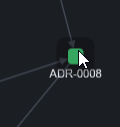

# REC-003 : quand je fais clique long sur un élément je veux que les lien s'affiche en coule…

quand je fais clique long sur un élément je veux que les lien s'affiche en couleur pour que je puisse comprendre à quoi il sont liée.

**À reprendre** (2026-10-23) : sur le clique long il faudrait en fait griser le reste du graph et mettre en évidence tous ce qui est connecter, et je n'ai pas la couleur des élément auquel il est connecter donc ne marche pas (traitement précédent : Appui long sur un nœud : ses liens prennent la couleur de l'élément d'en face, le reste s'estompe ; « effacer » ou Échap pour revenir.)

## Traitement

**traitee** : À l'appui long, le reste du graphe passe en gris sans titres, les nœuds connectés gardent leur couleur (cerclés, liens à leur couleur) et sont listés avec leur puce sous le graphe, un clic centrant sur chacun.

Commit : `21f19e9`
