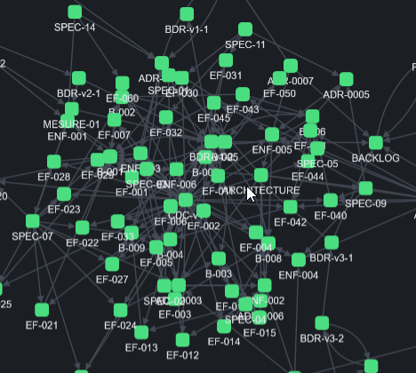
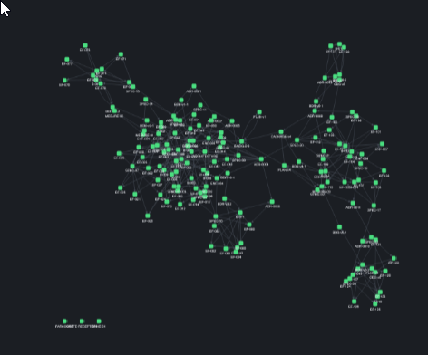

# REC-004 : certaine zone sont trop dense et un fois zoomer au max je ne vois pas clairement…

certaine zone sont trop dense et un fois zoomer au max je ne vois pas clairement les nom il faut que l'espacement entre les puce soient plus important

## Traitement

**traitee** : Espacement des nœuds environ triplé (répulsion, longueur des liens, chevauchement) et graphe sur toute la largeur de l'écran.

Commit : `a9e4344`
