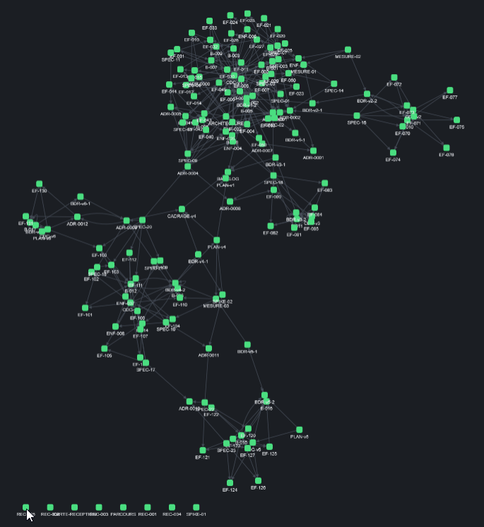
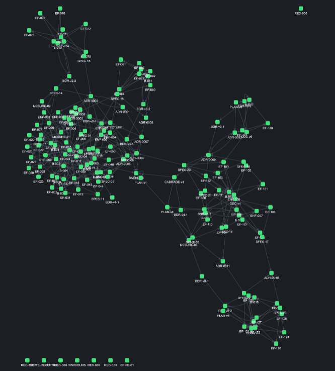
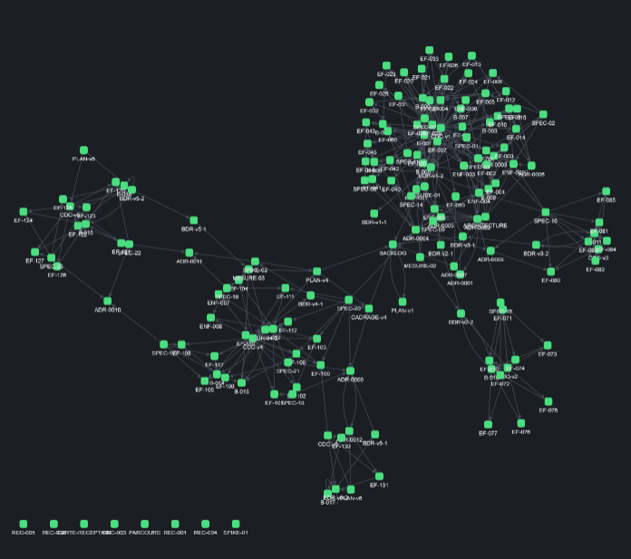

# REC-006 : alors je retrouve la carte globale mais 3 clique trois orientation différente on…

alors je retrouve la carte globale mais 3 clique trois orientation différente on va fixer un cap et ce sera toujour le même

