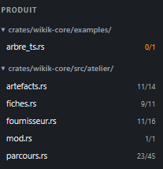

# REC-008 : il faut un bouton pour refermer tous les accordéons

il faut un bouton pour refermer tous les accordéons

## Traitement

**traitee** : Bouton ⊟ « Replier tout » en tête du panneau, dans toutes les sections.

Commit : `d84b878`
