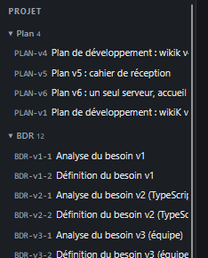

# REC-010 : bouton pour replier tous les accordéons en une fois

bouton pour replier tous les accordéons en une fois

## Traitement

**traitee** : Bouton ⊟ « Replier tout » en tête du panneau, dans toutes les sections.

Commit : `d84b878`
