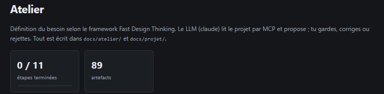
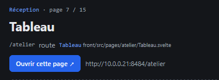

# REC-014 : j'ai pas compris cette page s'appele tableau mais ça ouvre l'atelier et je voudr…

j'ai pas compris cette page s'appele tableau mais ça ouvre l'atelier et je voudrais que cet atelier s’appelle Design thinking

