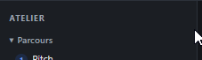

# REC-016 : il faut pouvoir retourner à la page d’accueil de l'atelier en passant par là

il faut pouvoir retourner à la page d’accueil de l'atelier en passant par là

## Traitement

**traitee** : Le titre du panneau (« DESIGN THINKING ») est un lien vers l'accueil de la section, dans toutes les sections.

Commit : `d84b878`
