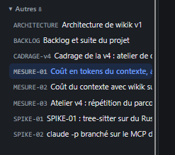

# REC-017.2 : backlog est complétement à par de cette catégorie, il faut une séction géstion e…

backlog est complétement à par de cette catégorie, il faut une séction géstion en tous premier lieu et mettre la baclogue dedans avec un  trailo : pour moi je parle d'une de ces page là http://10.0.0.21:8484/projet/PLAN-v4 par exemple

