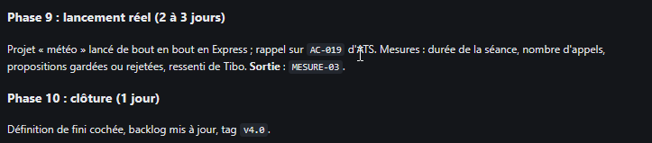

# REC-018.2 : j'ai beaucoup d'élément qui dans cette page n'ont pas de lien c'est génant car s…

j'ai beaucoup d'élément qui dans cette page n'ont pas de lien c'est génant car si le llm parcourt ce contenu il n'a pas de lien direct pour minimser la conso de token : ici http://10.0.0.21:8484/projet/PLAN-v4 . il faut que tout quote d'un doc/code... soit directement lier à celui ci

## Traitement

**traitee** : Dans les documents, la doc du code et les tableaux, tout identifiant connu (MESURE-03, EF-100…), chemin de fichier ou `chemin::Symbole` cité est un lien, sans [[...]] ; les identifiants inconnus (AC-019 d'ATS) restent du texte. Pour le LLM, ces identifiants sont déjà les clés des outils document, exigence et symbole.

Commit : `9b91f82`
