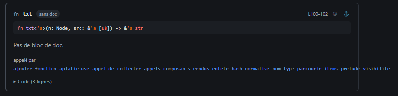

# REC-021 : http://10.0.0.21:8484/produit/crates/wikik-core/src/lang/rust.rs

http://10.0.0.21:8484/produit/crates/wikik-core/src/lang/rust.rs 
dans cette page j'ai les lien que sorte du cadre

## Traitement

**traitee** : Les listes « appelé par » et « appelle » passent à la ligne et restent dans la cellule.

Commit : `e1712d9`
