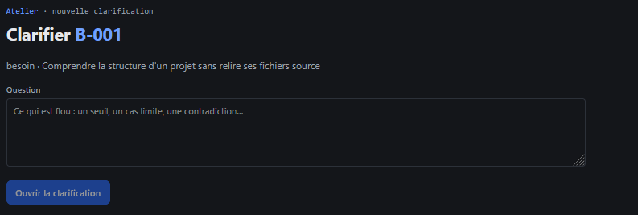
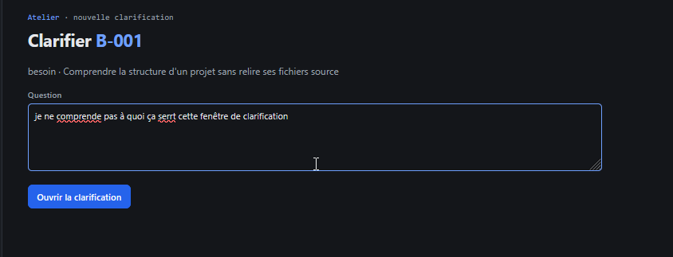
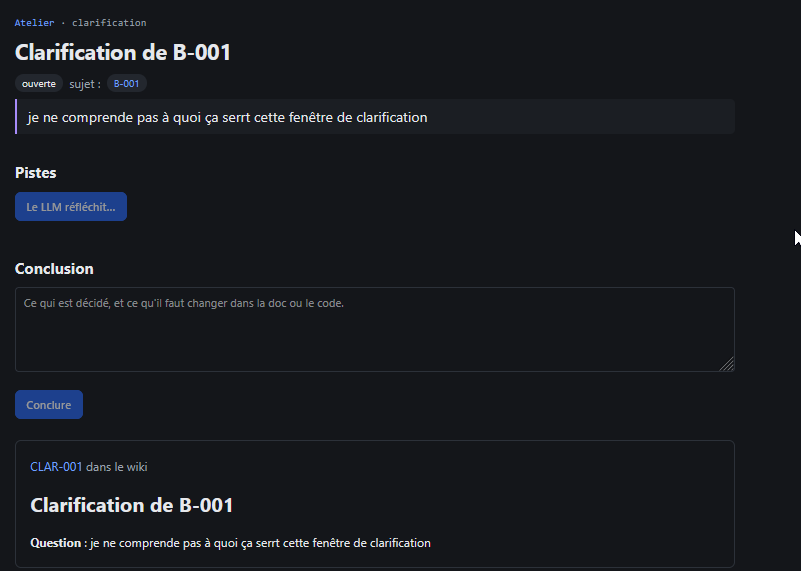
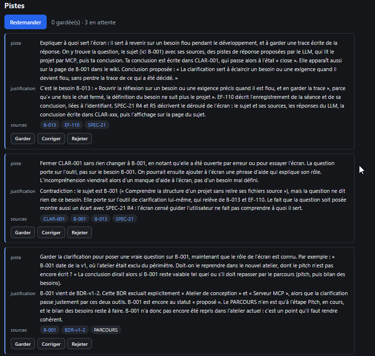
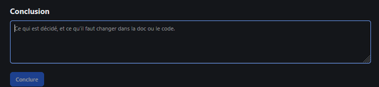

# REC-024.2 : http://10.0.0.21:8484/clarifier/B-001

http://10.0.0.21:8484/clarifier/B-001 
je suppose que c'est ça, je voudrais une section dédier à cette atelier complètement à part du design thinking dans la séction projet, en plus j'ai fait un hors sujet alors que c'est clairement le ligne du besoin qui doit être reprise, 
pour moi je lance une clarification et j'arrive sur une fenêtre directement avec des proposition issus de la données à clarifier. 
et la séction conculsion n'est pas utile l'utilisateur rejet/corrige/garde c'est ça qui fait ofrfice de réponse

## Traitement

**traitee** : Les clarifications ont leur groupe dans la section Projet, à part du Design thinking ; « clarifier » sur un document ouvre directement l'écran avec les pistes du LLM tirées du sujet, sans question à écrire ; plus de section Conclusion : les pistes gardées, corrigées ou rejetées font la réponse.

Commit : `ac26315`
