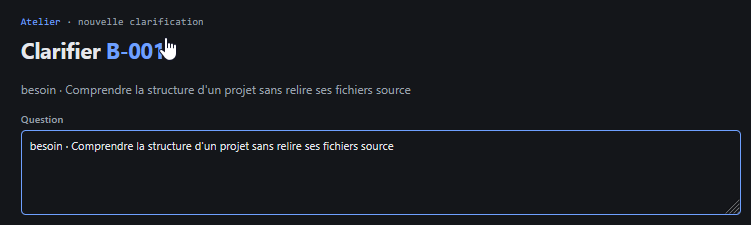

# REC-025 : alors celle ci je comrpend pas du tous c'est ça http://10.0.0.21:8484/clarifier/…

alors celle ci je comrpend pas du tous c'est ça http://10.0.0.21:8484/clarifier/B-001 ou ça http://10.0.0.21:8484/clarification/CLAR-003

## Traitement

**traitee** : Un seul écran : /clarifier/B-001 n'est plus qu'un passage qui ouvre (ou reprend) la clarification /clarification/CLAR-xxx du sujet.

Commit : `ac26315`
