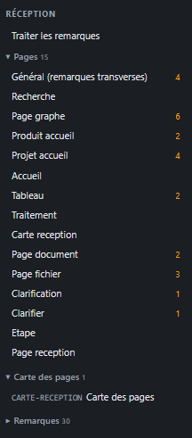

# REC-026 : je veux retrouver ma structure des page dans le volet d'exploration, par exemple…

je veux retrouver ma structure des page dans le volet d'exploration, par exemple page accueil projet > page clarifier > page clarification, j'ai besoin de voir ma structure au premier coup d'oeil

