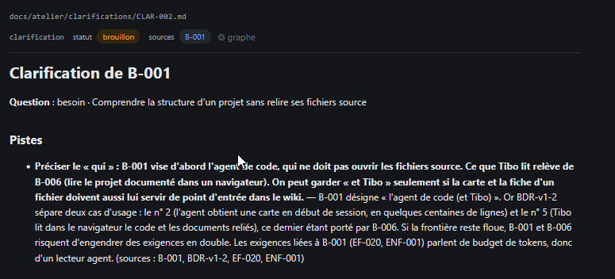

# REC-034 : impossible de reprendre la clairifiaction

impossible de reprendre la clairifiaction

## Traitement

**traitee** : La page d'une clarification dans Projet a un bouton « Reprendre la clarification → » ; le tableau de bord a « Reprendre » par sujet.

Commit : `ac26315`
