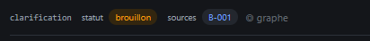

# REC-035 : j'ai un brouillion que je ne peux plus traiter...

j'ai un brouillion que je ne peux plus traiter...

## Traitement

**traitee** : Un brouillon se reprend (bouton « Reprendre ») ; « Clarifié : terminer » le clôt avec les pistes gardées, « Rouvrir » le rouvre.

Commit : `ac26315`
