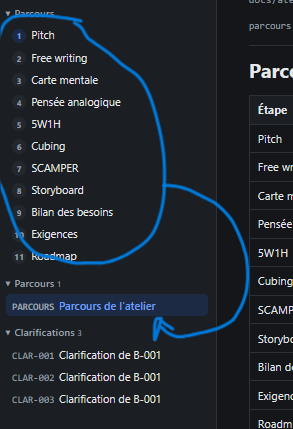

# REC-039 : un atelier s'inscrit dans un parcour il peu y avoir plusieur parcour en cours su…

un atelier s'inscrit dans un parcour il peu y avoir plusieur parcour en cours sur un même projet, il faut pourvoir ajouter un parcours avec un plus dans la séction parcours

