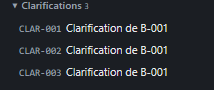

# REC-040.2 : il faut que cette données soit sutructuer avec par exemple ici le B-001 qui doit…

il faut que cette données soit sutructuer avec par exemple ici le B-001 qui doit regrouper les trois clarification, et un statut quand tout à été clarifier et jugé finir par l'utilisateur

## Traitement

**traitee** : Les clarifications sont rangées sous leur sujet (B-001 regroupe ses trois clarifications) avec l'état du sujet : « clarifié » quand toutes sont closes, « en cours » sinon ; même regroupement dans le tableau de bord.

Commit : `ac26315`
