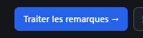

# REC-041 : ici ça doit envoyer directement au terminal en cours d'éxecutuion l'instructuion…

ici ça doit envoyer directement au terminal en cours d'éxecutuion l'instructuion qu'il faut lancer le traitement, attention prevoir dans les paramètre un prompt pour le traitement des remaque (par exemple il faut obliger le modél à commencer par un plan)

## Traitement

**traitee** : « Traiter avec l'agent ↗ » envoie la consigne de traitement dans le terminal : collée dans l'agent s'il tourne, sinon l'agent est lancé avec elle. La consigne se règle dans les Paramètres ; par défaut, elle oblige l'agent à commencer par un plan et à attendre la validation.

Commit : `ec52b94`
