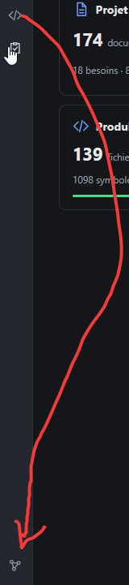

# REC-042 : regroupe graphe et code dans un seul menu au dessus des paramètres

regroupe graphe et code dans un seul menu au dessus des paramètres

## Traitement

**traitee** : Le code et son graphe forment la section « Code », rangée en bas de la barre d'activité juste au-dessus des Paramètres (le lien Graphe est en tête de son panneau).

Commit : `bd9766a`
