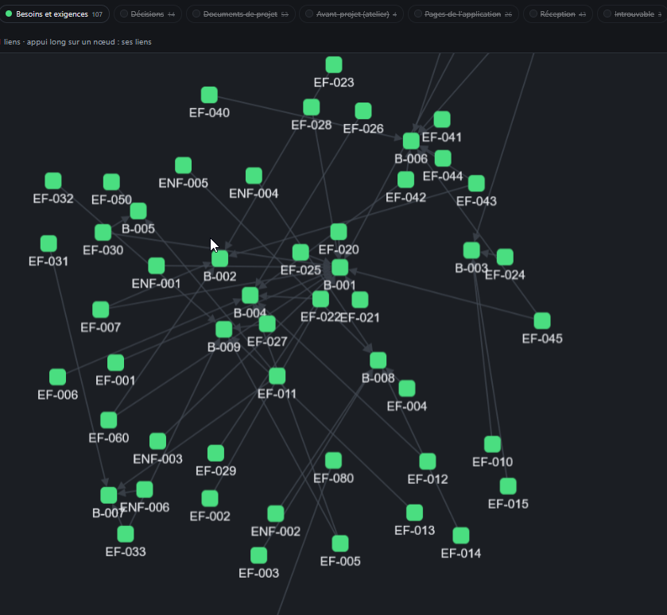

# REC-044 : les besoin et exigences/decision/document projet/ sont relier

les besoin et exigences/decision/document projet/ sont relier 
code/avant projet / pages application, 

il faut si il existe une lien entre les partie du code ou entre des pages application que l'on voit les lien entre chaque partie

