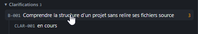
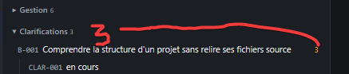
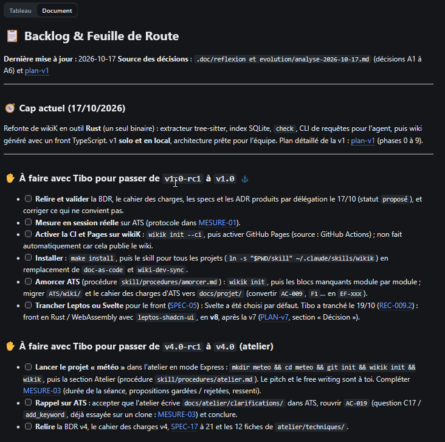

# REC-048 : il faut que l'indicateur de nouveauté soit répercuté sur l'accordéon supérieur o…

il faut que l'indicateur de nouveauté soit répercuté sur l'accordéon supérieur on garde ne nombre de document mais il faut indique dans chaque section les taches nécessitant un avis de l'utilisateur, par exemple backlog j'ai aucune visu de combien de tache sont à traité et nécessite mon approbation et ma relecture, donc il faut que ca remonte (comme dans clarification) dans chaque page, puis remonter dans l'accordéon pour que l'on puisse tous voir en un coup d'oeil.

