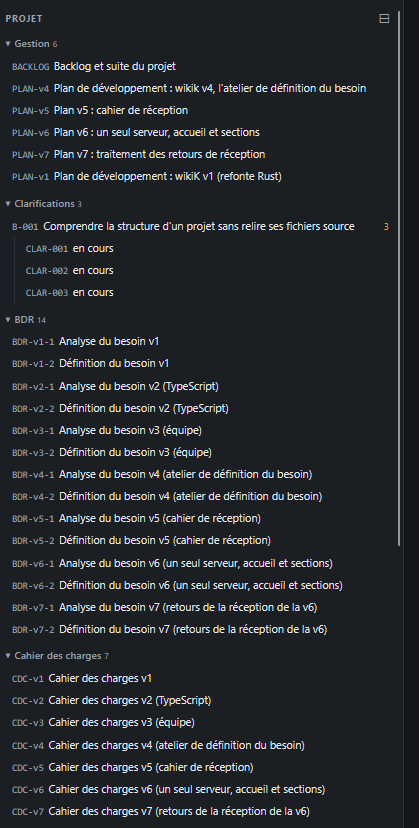
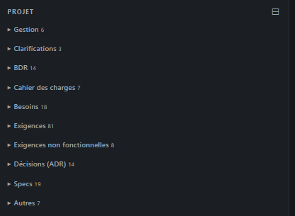

# REC-049 : quand on arrive sur la page tous les accordéon sont ouvert, il faut pour tous le…

quand on arrive sur la page tous les accordéon sont ouvert, il faut pour tous le site (hors code) que les accordéon soient fermer à l'arrivé sur la page.

## Traitement

**traitee** : Hors du panneau Code, tous les accordéons des panneaux sont fermés à l'arrivée ; seul celui de la page ouverte se déplie.

Commit : `bd9766a`
