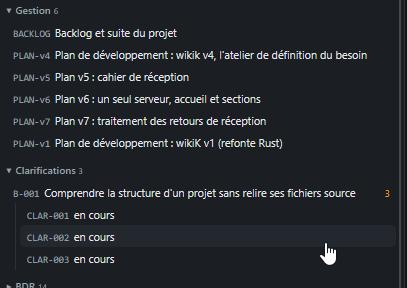

# REC-051 : il faut séparer le menu géstion, un séction plan a part, ensuite dans sous secti…

il faut séparer le menu géstion, un séction plan a part, ensuite dans sous section où il faut rappler tout les pages nécessitant une intervention de l'utilisateur dans le menu géstion. et une autre sous séction avec les favoris de l'utilisateurs.

## Traitement

**traitee** : Le volet Projet a une Gestion (backlog, sous-section « À traiter » qui rappelle tout ce qui demande ton intervention, sous-section « Favoris ») et un groupe « Plans » à part.

Commit : `c79f76f`
