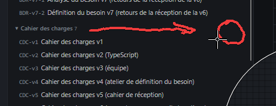

# REC-054 : dans ce qui est à relire j'ai l'impression que tous et n'import quoi y est mis i…

dans ce qui est à relire j'ai l'impression que tous et n'import quoi y est mis il faut revoir les régle pour ne mettre que ce qui est important, voir devans chaque séction je veux qu'il y ai un paramètre de réglage qui permet de créer un prompt systeme pour dire comment doit être stucture les données de la séction

