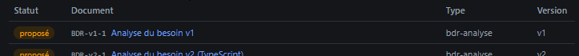
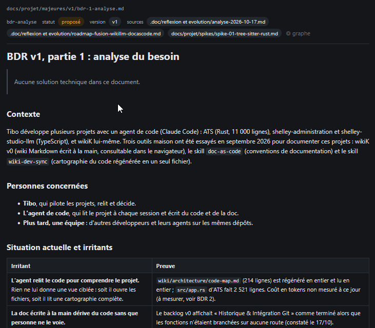

# REC-056 : tu me propose une relécture mais je ne peux rien reprendre! en fait je peux ni v…

tu me propose une relécture mais je ne peux rien reprendre! en fait je peux ni validé ni corrigé. donc le doc qui s'ouvre doit permettre une total édition des données

