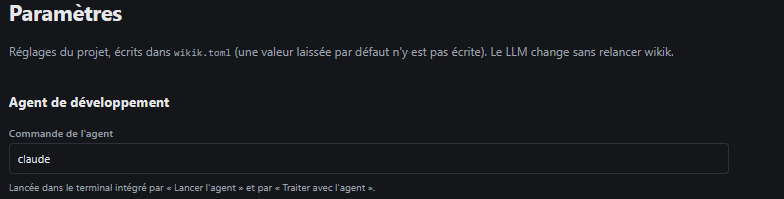

# REC-057 : ok la on est sur une bonne catastrophe...

ok la on est sur une bonne catastrophe... 
déjà il faut des accordéons en fonction de ce qu'on doit faire
ensuit il faut un connecteur comme sur ATS-cv-editor de LLM et je veux pourvoir choisir entre claude/agy/mistral le model que je vais connecter à mon wiki,

