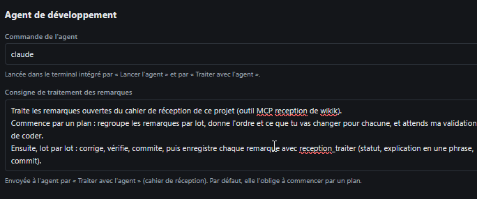
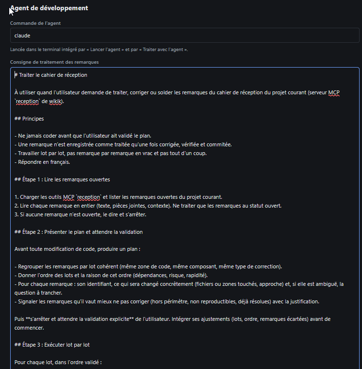

# REC-058 : pour les sections c'est vraiment les prompt que tu utilise et pas des exemples q…

pour les sections c'est vraiment les prompt que tu utilise et pas des exemples que tu m'a générer. si c'esst bien tes prompt, merci de les mettre dans un format skills car là c'est jetter comme ça et c'est nul, dans mon cas j'ai juste en 2 minute demander à claude dans un chat de me faire un vrai skills!!

## Traitement

**traitee** : Les consignes sont désormais de vrais skills (SKILL.md avec name et description, en sections) dans .claude/skills/ du projet, et ce sont exactement les textes envoyés ; le skill de traitement reprend celui que tu avais fait (plan validé, lots, reception_traiter).

Commit : `b904a4a`
