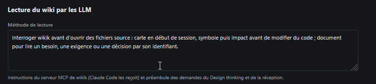

# REC-060 : pareil le skill ici est nul

pareil le skill ici est nul

## Traitement

**traitee** : La consigne de traitement est le skill wikik-traiter-reception, complet ; « Traiter avec l'agent » l'installe dans le projet et l'envoie à Claude Code par son nom (/wikik-traiter-reception).

Commit : `b904a4a`
