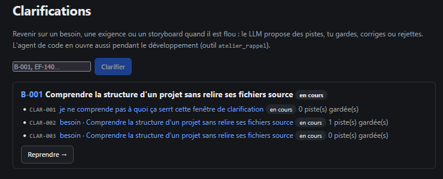

# REC-063 : très bien mais pourquoi ne pas reprendre le model de relecture, on ne doit pas c…

très bien mais pourquoi ne pas reprendre le model de relecture, on ne doit pas changer l'xp de l'utilisateur 
ensuite pour chaque section à clarifier il faut pouvoir les supprimer et

## Traitement

**traitee** : Les clarifications reprennent le modèle de la relecture (tableau, filtres par sujet et par état) ; chaque ligne a Reprendre et Supprimer, et « Supprimer le sujet » efface toutes celles d'un sujet (Ctrl+Z pour annuler).

Commit : `8c4e9b5`
