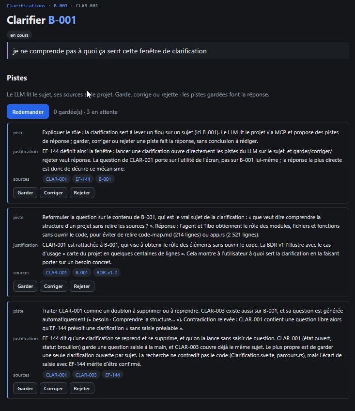

# REC-064 : donc le modele n'analyse toujours pas si la c'est hors sujet

donc le modele n'analyse toujours pas si la c'est hors sujet

## Traitement

**traitee** : Le LLM suit désormais le skill wikik-clarification : il juge d'abord si la question porte sur le sujet et, si elle est hors sujet, le dit (champ hors_sujet) ; l'écran l'affiche en bandeau orange en tête des pistes.

Commit : `8c4e9b5`
