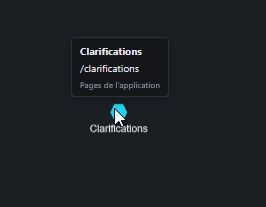

# REC-071 : pourquoi tu ne me mets pas le lien de la page (même si c'est un exemple) je vois…

pourquoi tu ne me mets pas le lien de la page (même si c'est un exemple) je vois bien que quelque chose existe dans mon graphe et point sur quelque chose?

## Traitement

**traitee** : Dans les pistes, les identifiants, chemins de fichier, symboles et routes d'écran cités (texte ou sources) deviennent des liens ; une route comme /clarifications mène à la carte de réception de l'écran.

Commit : `8c4e9b5`
