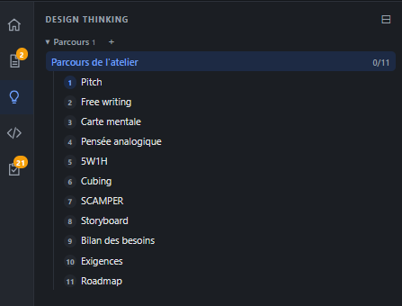

# REC-072 : j'ai deux chose dans cette atelier de design thinking,

j'ai deux chose dans cette atelier de design thinking, 
la partie design thinking : c'est un altelier pour justement en partant d'un pitch sortir des idées et des besoins sturcutré, un atelier doit avoir un titre/numéro de session un status... 
ensuit j'ai une partie clarification dans laquelle je vais aller trouver les point identifier comme à clarifier et que l'on doit traité, si le model ne sait pas comment arbitré c'est dans cette partie qu'on le voit,

## Traitement

**traitee** : Le Design thinking a deux parties : les ateliers (chaque parcours est une session avec numéro, titre, version, statut) et, à part, les clarifications, là où l'on voit ce que le modèle n'a pas su arbitrer.

Commit : `8c4e9b5`
