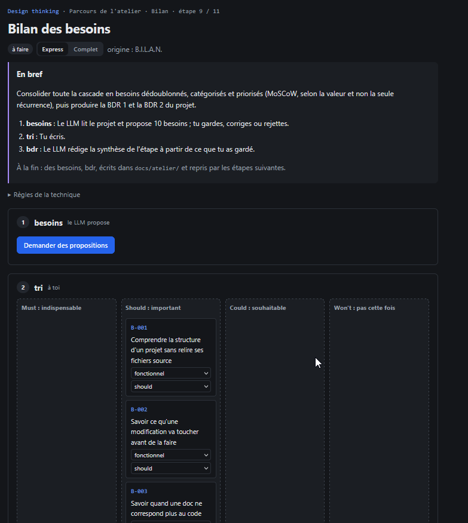

# REC-076 : pourquoi il est déjà remplis alors que l'atelier n'est pas encore écrit,il y'a d…

pourquoi il est déjà remplis alors que l'atelier n'est pas encore écrit,il y'a des lien utilsié à tord qui point sur les mauvaise élément

