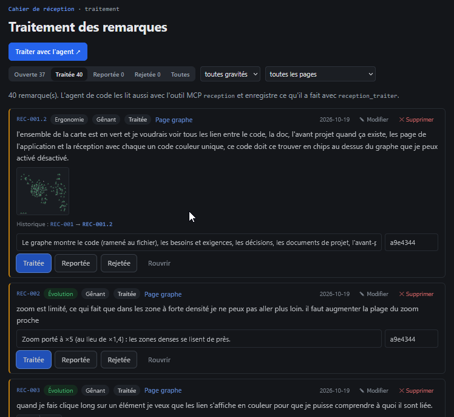

# REC-079 : je veux pouvoir validé dans cette section celle que moi utilisateur je considére…

je veux pouvoir validé dans cette section celle que moi utilisateur je considére comme traité

## Traitement

**traitee** : Une remarque traitée se valide dans le traitement (« ✓ Je valide ») ou se renvoie à l'agent (« ↺ À reprendre » avec ce qui reste à faire, qu'il lira) ; filtres « À valider » et « Validées ».

Commit : `805ae58`
