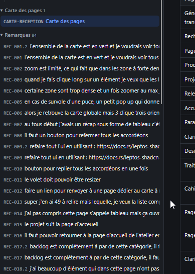

# REC-082 : il faut un code couleur pour savoir sur quel version/comit à été publier cette é…

il faut un code couleur pour savoir sur quel version/comit à été publier cette évolution

## Traitement

**traitee** : Code couleur par version : chaque version publiée a sa teinte (légende en tête du cahier et du traitement), bleu = poussé non publié, orange = pas poussé ; les remarques du volet Réception et les pages du cahier portent ces couleurs.

Commit : `805ae58`
