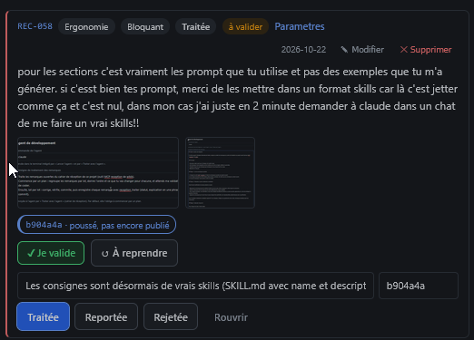
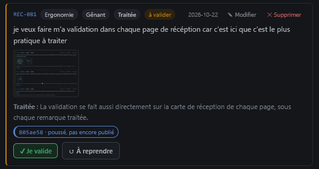

# REC-085 : je veux avoir les deux même interface de récéption

je veux avoir les deux même interface de récéption

## Traitement

**traitee** : La carte d'une page et le Traitement affichent désormais exactement le même composant de remarque, avec les mêmes gestes.

Commit : `6b59b6b`
