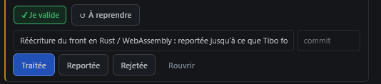
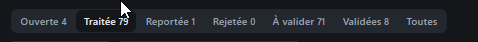

# REC-086 : il faut quelque chose qui fusionne les états de traitement, en reprenant les éta…

il faut quelque chose qui fusionne les états de traitement, en reprenant les étape de la barre du haut avec un sorte de slider, quand l'utilisateur ouvre une réception elle est ouverte, ensuite l'agent de code la passe en traité ensuite l'uitilisateur la passe en validé ...

## Traitement

**traitee** : Les états sont fusionnés sur un curseur Ouverte (déposée par toi) → Traitée (par l'agent) → Validée (par toi), où un clic fait avancer la remarque (explication pour traitée, ce qui reste à reprendre pour revenir à ouverte), avec Reporter et Rejeter à côté.

Commit : `6b59b6b`
