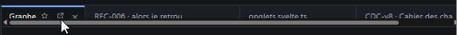

# REC-088 : le slider des onglet recouvre le text des onglet, il faut augmenté la taille des…

le slider des onglet recouvre le text des onglet, il faut augmenté la taille des onglets

## Traitement

**traitee** : Onglets plus hauts (36 px) et barre de défilement masquée : la barre défile à la molette et l'onglet actif est ramené dans la vue.

Commit : `4846cd5`
