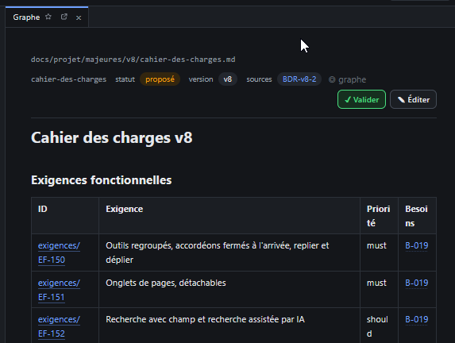

# REC-089 : quand je ferme les onglet le dérnière onglet ouvert n'affiche pas sont contenu m…

quand je ferme les onglet le dérnière onglet ouvert n'affiche pas sont contenu mais celui du précédent

