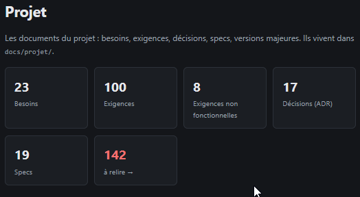

# REC-090 : en fait il me faut un état de suivie et pas un récape des élements je n'ai qu'un…

en fait il me faut un état de suivie et pas un récape des élements je n'ai qu'une boite à relire alors qu'il me faudrait l'état du a relir, a validé ....

## Traitement

**traitee** : L'accueil Projet montre l'état de suivi de chaque version (à relire, validés, tests validés, documents) à la place du récapitulatif par type.

Commit : `2ffbfbd`
