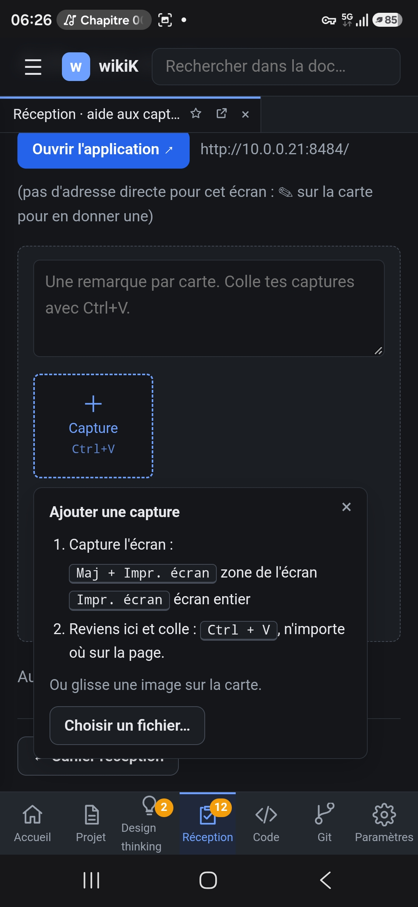

# REC-092 : Dans la version mobile il faut que le bouton capture récupère l'image dans le pr…

Dans la version mobile il faut que le bouton capture récupère l'image dans le presse papier si c'est une image

## Traitement

**traitee** : Sur téléphone, la tuile Capture prend directement l'image du presse-papiers quand le navigateur l'autorise (https) ; sinon, comme en http sur 10.0.0.21, l'aide propose une zone où coller par appui long et les raccourcis de capture du téléphone.

Commit : `6b59b6b`
