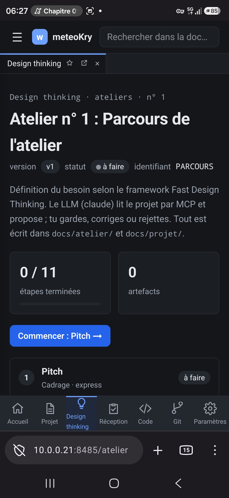

# REC-093 : Sir mobile je ne peux pas modifier le nom de l'atelier ni ces méta data

Sir mobile je ne peux pas modifier le nom de l'atelier ni ces méta data

## Traitement

**traitee** : Le bouton « ✎ Modifier l'atelier » (nom, version, statut) s'affiche désormais aussi sur téléphone : il était réservé au poste du propriétaire alors que le serveur accepte ces écritures de l'atelier.

Commit : `8b88788`
