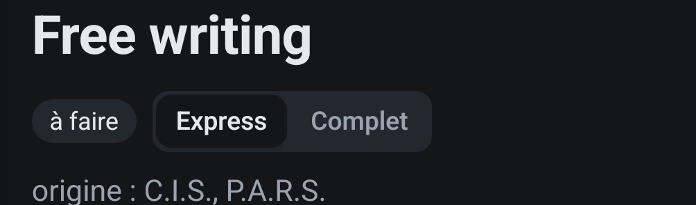

# REC-094 : L'option expresse ou complet n'est a mettre que sur l'ensemble de l'atelier disg…

L'option expresse ou complet n'est a mettre que sur l'ensemble de l'atelier disgn thinking.
Et quand on choisit l'express l'utilisateur va cocher les ateliers qu'il veut traiter

