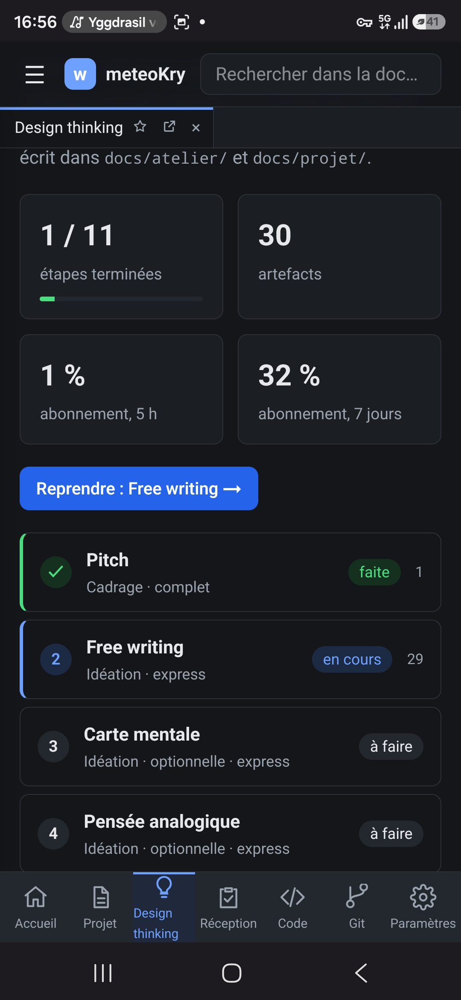

# REC-098 : Je ne retrouve aucun des skills pour l'atelier design thinking. Or je veux pouvo…

Je ne retrouve aucun des skills pour l'atelier design thinking. Or je veux pouvoir les faire évoluer/corrigé pour chaque atelier

## Traitement

**traitee** : Chaque étape a l'encart ⚙ de sa fiche de technique (les consignes réellement envoyées au LLM), que l'on corrige pour l'atelier en cours seulement (ADR-0019, copie dans le dossier de l'atelier) ou que l'on ramène à l'origine.

Commit : `8b88788`
