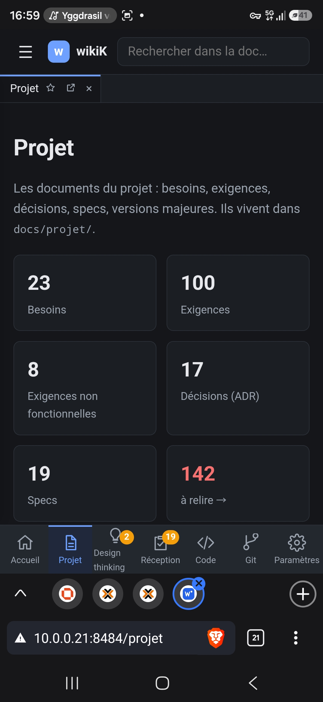

# REC-099 : Comment sur la page projet j'accède a mon contenu je ne retrouve pas tout les ca…

Comment sur la page projet j'accède a mon contenu je ne retrouve pas tout les catégories. Trouve une solution pour que depuis l'accueil en mode mobil il soit possible d'accéder plus loins que la page d'accueil d'une section

## Traitement

**traitee** : L'accueil Projet contient l'arbre complet des versions (repliable jusqu'aux tests) et les documents transverses : sur téléphone, on atteint chaque document sans passer par le volet.

Commit : `2ffbfbd`
