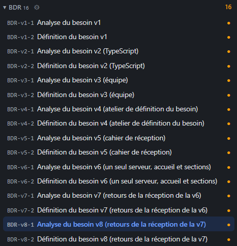
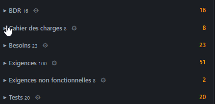

# REC-101.2 : dans arborescence voici mon besoin :

dans arborescence voici mon besoin :
- pour le BDR tu me double les doc, tu me fais l’analyse et ensuite la définition, 
- ensuite j'ai un cahier des charge 
- et ensuite j'ai de besoin, exigence, test ... 
ça me fait une énorme masse de document et en plus il se retrouve chaqu'un avec leur catégorie, c'est pas lible ni pour moi ni pour le model, il faut que ce soit structuré ça par d'une demande d'évolution dans une version, puis analyse, puis définition ensuite un cahier des charge avec des besoins qui sont remplit par des exigence et une exigence à un/des test. 
l’objectif c'est identifie en une fois tout la structure d'une version, et un fois que ce sera fait il ne sera pas necessaire d'afficher ensuite tout les catégorie, tous ce trouvera sous une version. 
Si j'ai oublier des élément qui serait à ajouter dans une version ajoute le

## Traitement

**traitee** : Le volet et l'accueil Projet sont rangés par version (ADR-0018), avec pour chacune la demande d'évolution, l'analyse, la définition, le cahier des charges et ses besoins, exigences et tests, puis ENF, ADR, specs, plan et autres, à la place des catégories à plat.

Commit : `2ffbfbd`
